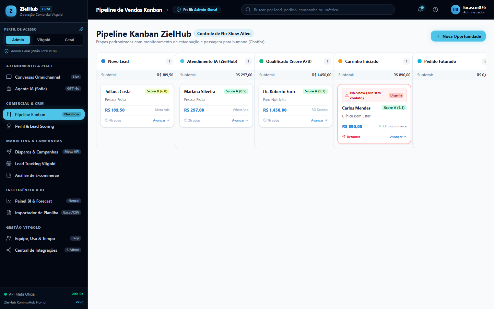
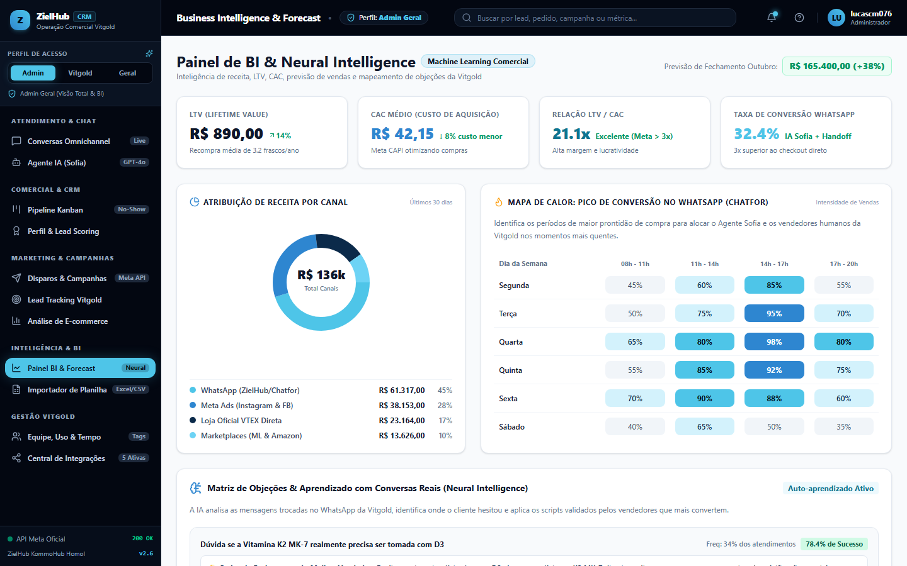
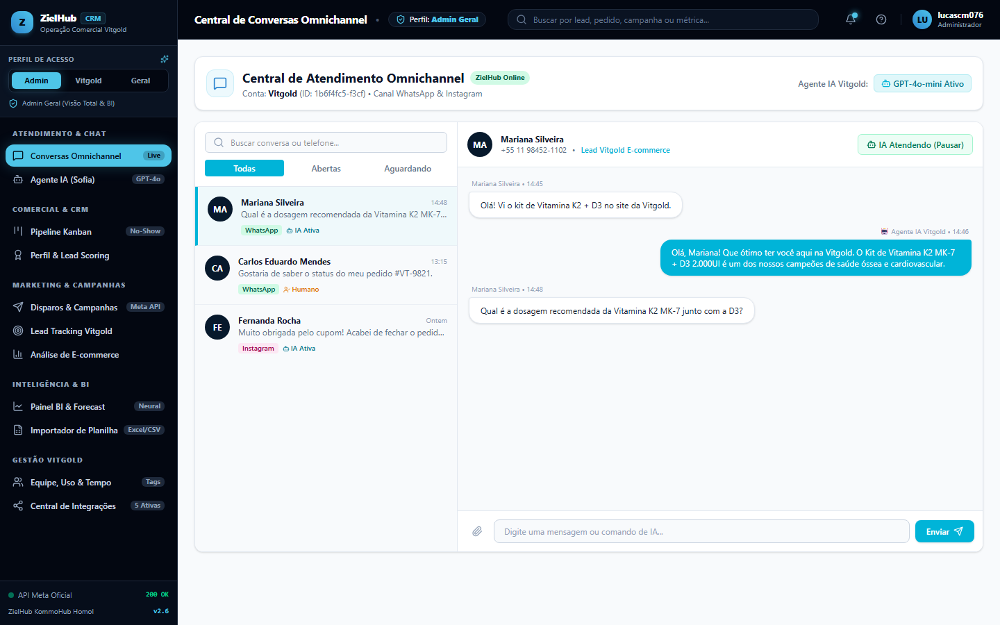
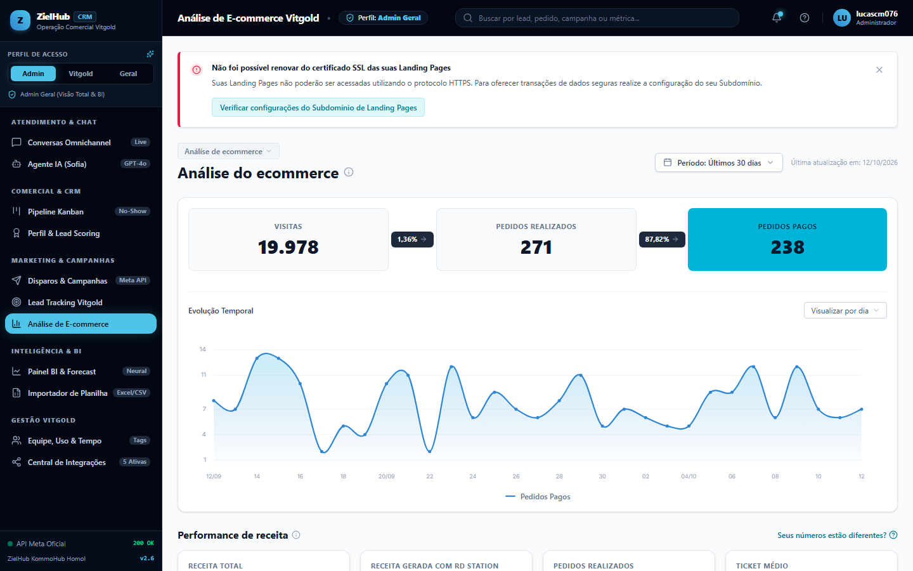
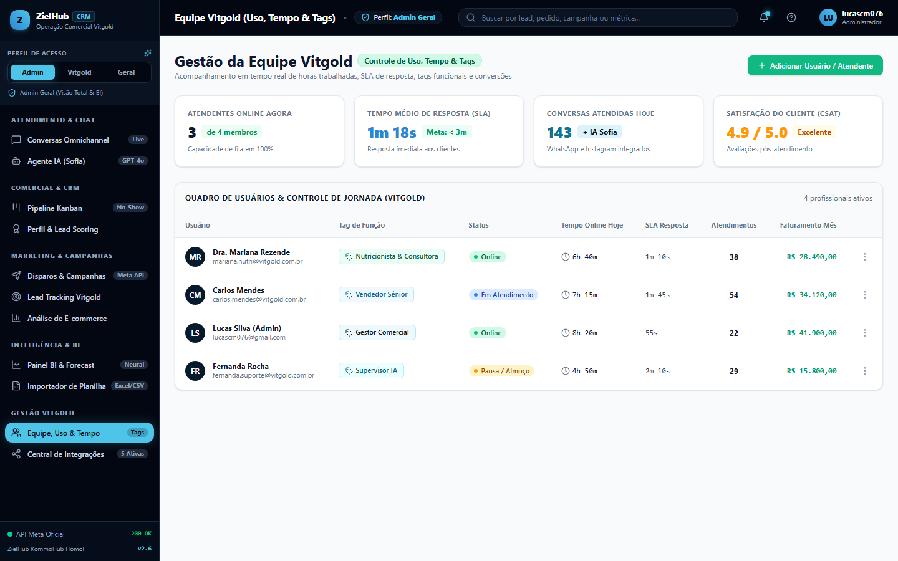
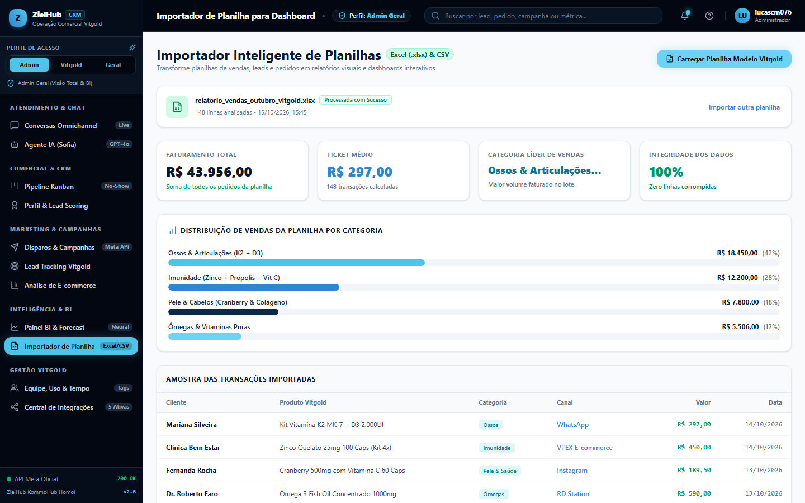

# ZielHub CRM • Operação Comercial & Vitgold Suplementos

Plataforma inteligente de CRM omnichannel, gestão comercial, análise de e-commerce e atendimento automatizado via IA Open Source (**Sofia**) com integração direta ao WhatsApp e ao catálogo oficial da **Vitgold Brasil** (`vitgold.com.br`).

---

## 🚀 Principais Módulos & Recursos

### 1. Central de Conversas Omnichannel & SDR Sofia
- **Sofia, SDR da Vitgold:** Usa um modelo local com contexto multi-turn e consulta as páginas oficiais de produtos para fundamentar respostas; quando não encontra a informação, responde “Vou verificar”.
- **WhatsApp Conectado em Tempo Real:** O QR Code, status, mensagens recebidas e envio de respostas ficam integrados diretamente na tela Conversas.
- **Auto-Pilot WhatsApp:** A SDR pode responder automaticamente aos clientes pelo WhatsApp enquanto o servidor local está ativo.

### 2. Perfis Dinâmicos com Troca nos Avatares (Fotos)
- **Lucas • ZielHub Admin:**
  - Visão executiva de negócios, BI & Forecast, Pipeline Kanban comercial e gestão de metas.
  - Identidade visual oficial da **ZielHub**: Obsidian (`#030711`), Ciano Elétrico (`#4EC5E8`) e Azul Técnico (`#2E86D0`) — *Zero Roxo*.
- **Sofia • Vitgold Operacional:**
  - Visão focada no e-commerce de suplementos, pedidos, giro de estoque por SKU (K2 MK-7, Cálcio+D3, Cranberry, Ômega 3 IFOS, Magnésio Dimalato).
  - Menus reordenados colocando a operação de loja no topo.
  - Diretriz visual estrita: **opções ativas em vermelho (`#DC2626`)** e **hover em azul (`#2563EB`)**.

### 3. Pipeline Kanban & Lead Scoring
- Pipeline estilo Kanban comercial com drag-and-drop (*hold & drop*) entre etapas.
- Sistema de Lead Scoring com pontuação em tempo real, critérios de engajamento e histórico.

### 4. Inteligência & E-commerce
- **Painel Operacional Vitgold:** Faturamento, frascos vendidos, prescritores/nutris e dias de cobertura de estoque.
- **Importador de Planilhas:** Importação e conversão de arquivos Excel/CSV em dashboards analíticos.
- **Equipe Vitgold:** Controle de ponto, tempo de uso e tags de função.

---

## 📸 Demonstração Visual da Plataforma

| Pipeline Kanban Comercial (Hold & Drop) | Painel BI & Forecast |
| :---: | :---: |
|  |  |

| Central de Atendimento & Sofia IA | Análise de E-commerce Vitgold |
| :---: | :---: |
|  |  |

| Gestão da Equipe (Uso, Tempo & Tags) | Importador Inteligente de Planilhas |
| :---: | :---: |
|  |  |

---

## 🛠️ Tecnologias Utilizadas

- **Frontend:** React 19, TypeScript, Tailwind CSS v4, Vite 8, Lucide React, Canvas Confetti.
- **Backend:** Node.js (ESM), Express 5, CORS.
- **WhatsApp Engine:** `@whiskeysockets/baileys` (v7), `qrcode`.
- **IA Engine:** Motor neural híbrido multi-turn local com indexação RAG do catálogo Vitgold e integração generativa.

---

## 💻 Como Rodar o Projeto

### Pré-requisitos
- Node.js 18+ (recomendado Node 20 ou 24)
- NPM

### Instalação
```bash
# Clone o repositório
git clone https://github.com/lucasmeireles076/crm_zielhub.git

# Acesse a pasta
cd crm_zielhub

# Instale as dependências
npm install
```

### Ativar conversa generativa local da Sofia
Para respostas abertas e contextualizadas, instale o [Ollama](https://ollama.com/download) e baixe o modelo configurado:
```bash
ollama pull qwen2.5:3b
```
Mantenha o Ollama em execução. No CRM, a tela **Agente IA** permite verificar a conexão, escolher outro modelo instalado e salvar as configurações. Sem o Ollama, saudações e algumas consultas simples continuam funcionando, mas perguntas abertas recebem um aviso em vez de uma resposta inventada.

### Execução em Desenvolvimento
Você pode iniciar o projeto de duas formas:

#### Opção A: Execução Unificada (Script Windows)
Clique duas vezes no arquivo `INICIAR_CRM.bat` na raiz do projeto.

#### Opção B: Terminal Manual
```bash
# Terminal 1: Iniciar o Frontend Vite
npm run dev

# Terminal 2: Iniciar o Servidor WhatsApp & IA
npm run server
```

- **Frontend:** [http://localhost:5173/](http://localhost:5173/)
- **Backend API & WhatsApp:** [http://localhost:3001/](http://localhost:3001/)

---

## 📂 Estrutura de Pastas

```
VITGOLD_CRM/
├── server/
│   ├── open-source-ai-engine.js  # Motor conversacional da Sofia & RAG Vitgold
│   ├── whatsapp-bot.js           # Servidor Express & Baileys WhatsApp Socket
│   └── unified-runner.js         # Orquestrador local do backend
├── src/
│   ├── components/               # Telas e componentes do CRM
│   │   ├── Header.tsx            # Header com troca de perfil nas fotos
│   │   ├── Sidebar.tsx           # Menu vertical reordenável por perfil
│   │   ├── ConversasView.tsx     # Central de atendimento omnichannel
│   │   ├── VitgoldDashboard.tsx  # Dashboard operacional exclusivo Vitgold
│   │   ├── FunisView.tsx         # Pipeline Kanban hold & drop
│   │   ├── AgenteIAView.tsx      # Configuração e testes da IA
│   │   └── ...
│   ├── types/                    # Definições de tipos TypeScript
│   ├── App.tsx                   # Roteamento e orquestração de perfis
│   └── main.tsx
├── DESIGN.md                     # Fonte da verdade de tokens visuais
└── package.json
```

---

## 📄 Licença & Propriedade
Projeto desenvolvido para a operação **ZielHub CRM** & **Vitgold Brasil**. Todos os direitos reservados.
